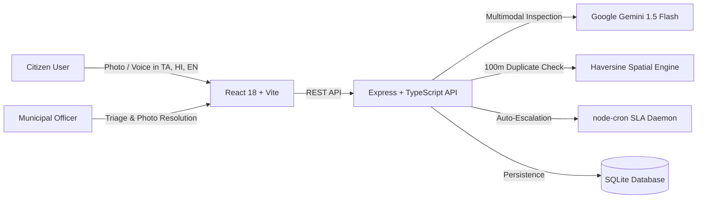
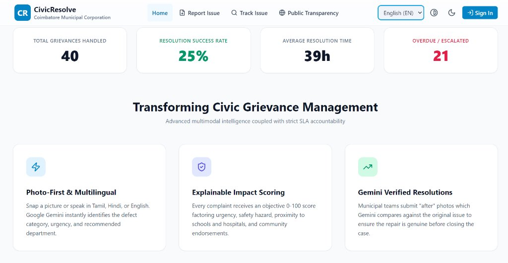

# CivicResolve 🏛️✨

> **AI-Powered Civic Grievance Management Platform**  
> Multimodal Intelligence • Strict SLA Accountability • Coimbatore Municipal Corporation Dataset

[](https://civicresolve-5-a0h5.onrender.com/)
[](https://nodejs.org/)
[](https://www.typescriptlang.org/)
[](https://opensource.org/licenses/MIT)

🔗 **Live App:** [https://civicresolve-5-a0h5.onrender.com/](https://civicresolve-5-a0h5.onrender.com/)

---

## 📌 Problem & Solution (At a Glance)

| ❌ The Old Problem | ✨ The CivicResolve Solution |
| :--- | :--- |
| **Complex Forms & Language Barriers** | **Photo & Voice First**: Snap a picture or speak in **Tamil, Hindi, or English**. Gemini AI instantly auto-detects defect, category, and department. |
| **Unfair "First-Come" Prioritization** | **Explainable Impact Score (0–100)**: Automatically prioritizes hazards near hospitals and schools over minor issues. |
| **Duplicate Complaint Clutter** | **100m Spatial Duplicate Detection**: Surfaces existing issues nearby; neighbors click **"+2 Support"** instead of filing duplicates. |
| **Ghost / Fake Resolutions** | **AI Before/After Proof**: Work crews must upload repair photos. Gemini verifies the fix visually before closing the ticket. |
| **Ignored Deadlines** | **SLA Timers & Auto-Escalation**: Strict departmental countdowns; overdue complaints auto-escalate to the top of the admin triage queue. |

---

## 🏛️ System Architecture



---

## 🎨 Application UI & Designs

### 1. Transparency & City Health Dashboard
Live metrics tracking total grievances, success rates, average resolution time, and active SLA escalations.


### 2. 4-Step Multimodal Grievance Wizard
Photo-first reporting, speech recognition in English/Tamil/Hindi, automated AI categorization, and interactive map pin.


---

## 🔑 Demo Accounts (Try It Live)

| Role | Email | Password | What You Can Do |
| :--- | :--- | :--- | :--- |
| **Admin** | `admin@civicresolve.gov.in` | `Admin@123` | Review Triage Queue, Verify Photo Resolutions, Manage SLAs |
| **Citizen** | `citizen@civicresolve.org` | `Citizen@123` | File Issues (Voice/Photo), Track Status, Endorse Issues (+2) |

---

## 🚀 Quick Run (Local Setup)

```bash
git clone https://github.com/bharanisankar18/CivicResolve.git
cd CivicResolve
npm install
npm run build
npm start
```
> App runs at **http://localhost:5000** (serves both API and compiled React frontend).

---

## 🛡️ Key Highlights
* **100% Test Pass Rate**: 18 test suites, 160 tests passing (Unit, Integration, BOLA Security, Performance).
* **WCAG 2.2 AA Accessible**: Dark/Light modes, OpenDyslexic font support, and full screen-reader compliance.
* **Zero-Downtime Resilience**: Automatic keyword fallback keeps the system 100% functional even if external AI APIs are unreachable.

---

<p align="center">
  <strong>Made with ❤️ by Bharani Sankar</strong>
</p>
