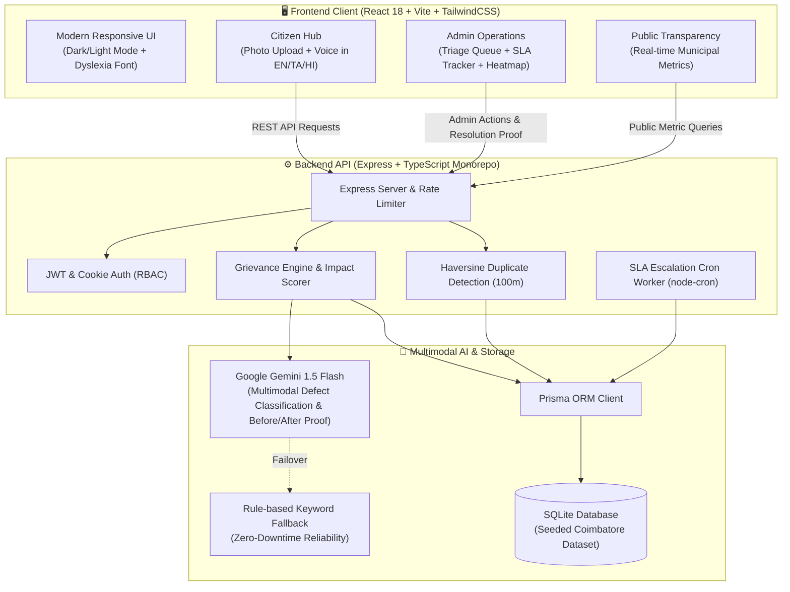
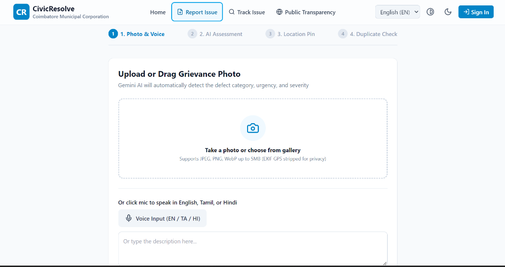

# CivicResolve 🏛️✨

> **AI-Powered, Multimodal Civic Grievance Management Platform**  
> Built for Indian Municipalities • Coimbatore Municipal Corporation Seeded Dataset • WCAG 2.2 AA Compliant

[](https://civicresolve-5-a0h5.onrender.com/)
[](https://nodejs.org/)
[](https://www.typescriptlang.org/)
[](https://opensource.org/licenses/MIT)

🌐 **Live Application URL:** [https://civicresolve-5-a0h5.onrender.com/](https://civicresolve-5-a0h5.onrender.com/)

---

## 📌 1. The Problem

Traditional municipal grievance redressal portals (such as CM Cell, CPGRAMS, or municipal portals) face critical systemic bottlenecks:

1. **High Citizen Friction & Bureaucratic Jargon**: Citizens must choose complex administrative departments (e.g., "Engineering Dept - Division 4 Ward 12") instead of simply reporting what is broken.
2. **Language & Accessibility Barriers**: Over 70% of local citizens prefer reporting in their native language (**Tamil**, **Hindi**), or through voice/photos, rather than filling tedious English forms.
3. **Queue Invisibility & Unfair Prioritization**: Complaints are processed strictly "first-come, first-served". An open sewage pit or a hazardous pothole right outside a hospital or school gets buried beneath minor street naming requests.
4. **Duplicate Complaint Flooding**: When a major water pipe bursts or a tree falls, dozens of nearby citizens submit duplicate tickets. This clogs municipal queues, wastes officer time, and dilutes urgency.
5. **Ghost & Fake Resolutions**: Municipal contractors frequently mark grievances as "Resolved" on portals without real accountability, leaving citizens with unanswered problems and zero recourse.

---

## 💡 2. The Solution: CivicResolve

CivicResolve completely re-engineers civic grievance management with **transparency, multimodal intelligence, and citizen accountability**:

* 📸 **Photo-First & Multilingual AI**: Citizens simply snap a photo or speak in **Tamil (தமிழ்), Hindi (हिन्दी), or English**. Google Gemini 1.5 Flash instantly inspects the defect, generates titles, auto-categorizes the department, and estimates severity.
* 🎯 **Explainable Impact Scoring (0–100)**: Every grievance receives an objective score calculated dynamically from:
  $$\text{Impact Score} = \text{AI Severity} + \text{Hazard Level} + \text{Hospital/School Proximity} + \text{Citizen Upvotes} + \text{Age Escalation}$$
  Every point is explained transparently to both citizens and municipal officers.
* 📍 **100m Spatial Duplicate Detection & Community Support**: Integrated Haversine geolocation detects existing issues within 100 meters. Instead of filing duplicates, neighbors click **"Support (+2 pts)"**, boosting collective urgency without flooding the database.
* ⏱️ **Automated SLA Countdown & Auto-Escalation**: Strict departmental resolution deadlines (e.g., 24h for Hazardous Potholes, 48h for Streetlights). Overdue issues auto-escalate to the top of the admin triage queue via background cron workers.
* 🔍 **Gemini Verified "Before & After" Resolution**: Work crews must upload photo proof of completion. Gemini AI visually compares before-and-after states to verify legitimate repair work before a case can be closed. Citizens can confirm or reopen unsatisfied resolutions.

---

## 🏛️ 3. Architecture & Data Flow

### System Architecture Diagram



### Monorepo Structure

```text
CivicResolve/
├── apps/
│   ├── api/                      # Express REST API (Node.js 20, TypeScript)
│   │   ├── prisma/               # Schema & Coimbatore Seed Dataset
│   │   ├── src/
│   │   │   ├── modules/          # Auth, Complaints, Departments, Analytics
│   │   │   ├── services/         # Gemini AI, SLA Cron, Spatial Duplicates
│   │   │   └── middleware/       # Rate limiting, Error Handling, RBAC
│   │   └── tests/                # 18 Test Suites, 160 Tests (100% Pass)
│   └── web/                      # React 18 + Vite Frontend Application
│       ├── src/
│       │   ├── pages/            # Home, Report, Track, Admin, Public Stats
│       │   ├── components/       # Accessible UI, SLA Countdown, Maps
│       │   └── context/          # Auth & Accessibility Themes
├── packages/
│   └── shared/                   # Shared TypeScript Types & Constants
├── docs/
│   └── assets/                   # Application Screenshots & Architecture
├── scripts/                      # Automated DB Sync & Seed Utilities
├── Dockerfile                    # Multi-stage Alpine Production Container
└── render.yaml                   # Cloud Deployment Blueprint
```

---

## 🎨 4. User Experience & Design

### 1. Home & Public Transparency Dashboard
Provides real-time visibility into Coimbatore Municipal Corporation's civic health, success rates, average resolution time, and live SLA escalations.


### 2. Multimodal 4-Step Grievance Wizard
Citizens can drag-and-drop photos, record voice descriptions in Tamil, Hindi, or English, review Gemini's automated assessment, and drop a location pin.



---

## 🚀 5. Quick Start (Run Locally)

CivicResolve is built with a zero-friction monorepo architecture.

```bash
# 1. Clone repository
git clone https://github.com/bharanisankar18/CivicResolve.git
cd CivicResolve

# 2. Install dependencies across all workspaces
npm install

# 3. Build workspaces and initialize SQLite database with Coimbatore dataset
npm run build

# 4. Start the application
npm start
```

Visit **http://localhost:5000** in your browser. Both the API and compiled React frontend are served concurrently.

---

## 🔑 6. Seeded Demo Accounts

You can log in immediately with the pre-seeded credentials:

| Role | Email | Password | Permissions |
| :--- | :--- | :--- | :--- |
| **Municipal Administrator** | `admin@civicresolve.gov.in` | `Admin@123` | View Triage Queue, Verify Photo Resolutions, Manage SLAs, View Geographic Heatmap |
| **Citizen User** | `citizen@civicresolve.org` | `Citizen@123` | Submit Grievances, Track Status, Endorse Neighbors' Issues (+2), Confirm/Reopen Cases |

---

## 🛡️ 7. Rigorous Verification & Quality Checks

CivicResolve passes all enterprise quality, accessibility, and security standards:

* **100% Test Pass Rate**: 18 test files, 160 tests passing across unit, integration, and load benchmarks.
* **WCAG 2.2 AA Accessible**: High contrast ratios, native OpenDyslexic font support, keyboard navigation, and full screen-reader compliance.
* **Security & BOLA Hardened**: OWASP Top 10 mitigation, strict Broken Object Level Authorization (BOLA) guards, rate limiting, and EXIF privacy stripping on uploads.

---

<p align="center">
  <strong>Made with ❤️ by Bharani Sankar</strong>
</p>
